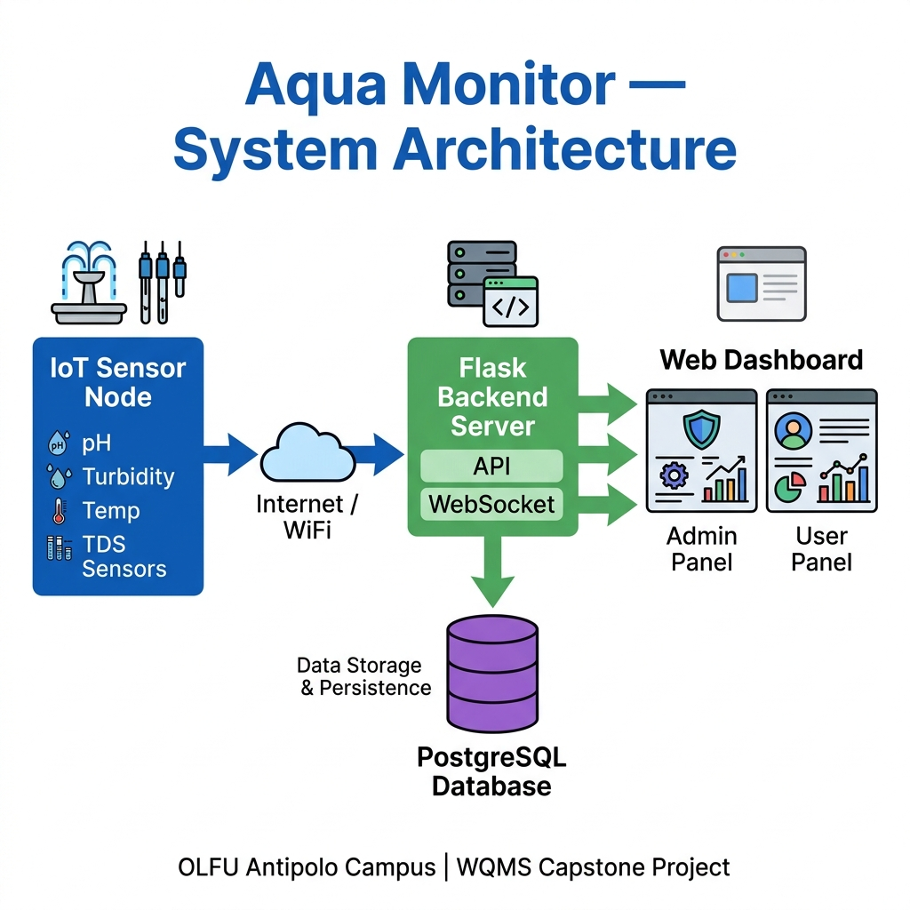
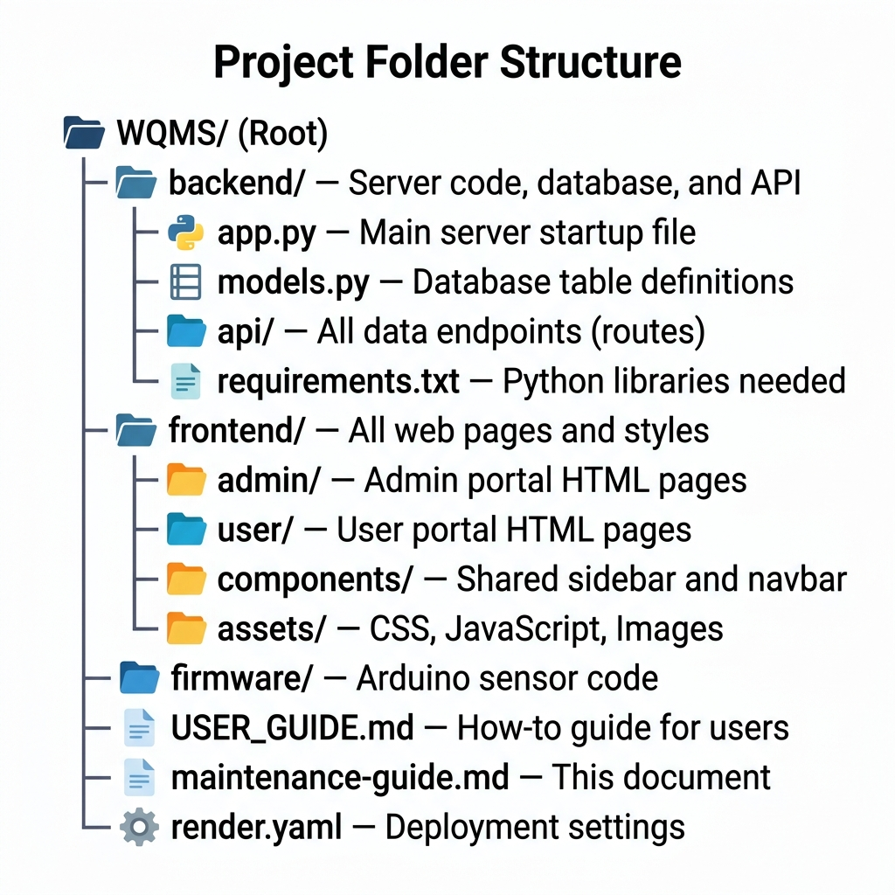
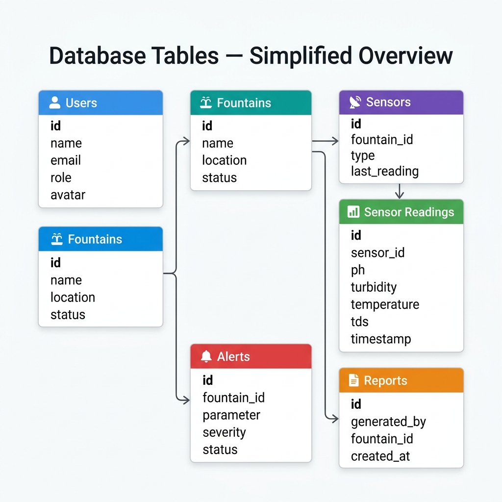
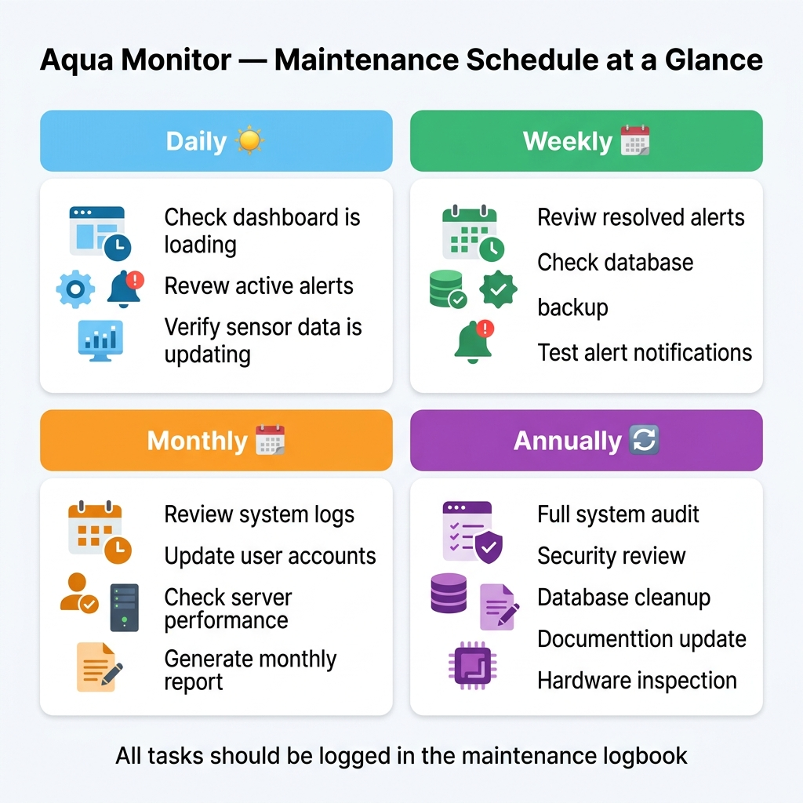
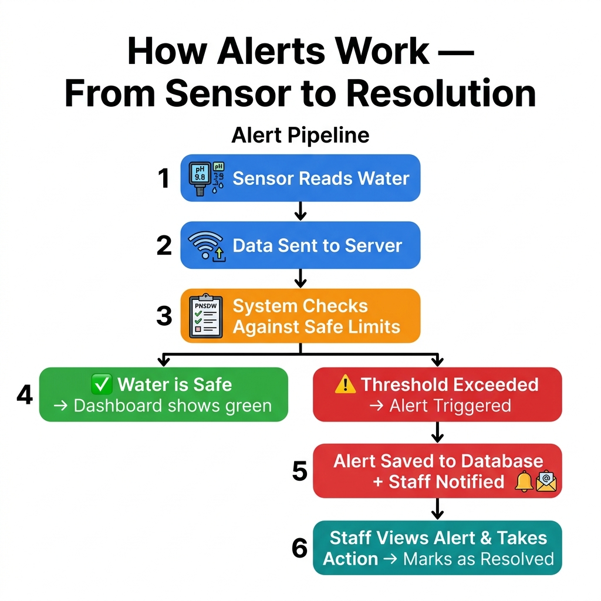
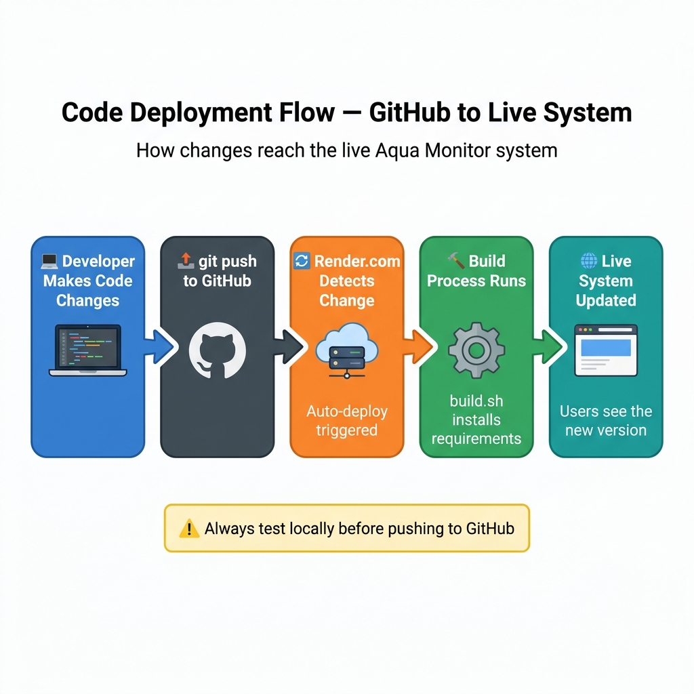

# 🔧 Aqua Monitor — Software Maintenance Guide

**Our Lady of Fatima University – Antipolo Campus**
Engineering Department | Water Quality Monitoring System (WQMS)
Document Type: Software Maintenance Manual

---

> **Who is this guide for?**
> This guide is written for the **Documentation Team** and any staff member responsible for maintaining the Aqua Monitor system. You do **not** need a technical background to understand this guide. Every technical term is explained in plain, everyday language.

> **How to use this guide:**
> Read it from beginning to end for a full understanding, or jump directly to a specific chapter using the Table of Contents below. Each chapter starts with a one-sentence summary of what it covers.

---

## 📋 Table of Contents

1. [Introduction & Purpose](#chapter-1-introduction--purpose)
2. [System Overview](#chapter-2-system-overview)
3. [System Components Map](#chapter-3-system-components-map)
4. [Technology Stack — In Plain Language](#chapter-4-technology-stack--in-plain-language)
5. [File & Folder Structure](#chapter-5-file--folder-structure)
6. [The Admin Panel — Page by Page](#chapter-6-the-admin-panel--page-by-page)
7. [The User (Operator) Panel — Page by Page](#chapter-7-the-user-operator-panel--page-by-page)
8. [The Backend API — What It Does](#chapter-8-the-backend-api--what-it-does)
9. [The Database — Tables & Relationships](#chapter-9-the-database--tables--relationships)
10. [Routine Maintenance Tasks](#chapter-10-routine-maintenance-tasks)
11. [How to Run & Restart the System](#chapter-11-how-to-run--restart-the-system)
12. [Alerts & How They Work](#chapter-12-alerts--how-they-work)
13. [Common Problems & Solutions](#chapter-13-common-problems--solutions)
14. [Update & Deployment Guide](#chapter-14-update--deployment-guide)

---

---

## Chapter 1: Introduction & Purpose

> **This chapter explains** what this document is, who it is for, and why it exists.

### 1.1 What Is This Document?

This is the **Software Maintenance Guide** for the **Aqua Monitor Water Quality Monitoring System (WQMS)**. It is a living document — meaning it should be updated whenever the system changes.

Think of this guide like the **instruction manual for a car**. The car (the system) runs on its own, but without a maintenance manual, nobody would know when to change the oil, what the warning lights mean, or what to do when something breaks down.

This guide does exactly that — it tells you:
- How the system is built
- What every part does
- How to keep it running well
- What to do when something goes wrong
- How to make and publish changes

### 1.2 Who Should Read This?

| Reader | Relevant Chapters |
|--------|-------------------|
| 📄 Documentation Team | All chapters — especially 1–5 and 10 |
| 🛠️ System Maintainer | Chapters 10, 11, 13, 14 |
| 👩‍💼 Project Manager | Chapters 1, 2, 10, 12 |
| 💻 Developer / Programmer | Chapters 4–9, 11, 14 |
| 🔬 Future Capstone Teams | All chapters |

### 1.3 About the Aqua Monitor System

**Aqua Monitor** is a capstone project developed by engineering students of **Our Lady of Fatima University (OLFU) — Antipolo Campus**. It is a smart monitoring system that automatically checks the water quality of campus drinking fountains and sends alerts if the water becomes unsafe.

| Field | Details |
|-------|---------|
| **Project Name** | Aqua Monitor (WQMS) |
| **Institution** | Our Lady of Fatima University — Antipolo Campus |
| **Department** | Engineering |
| **Primary Users** | Campus Facility Staff & Administrators |
| **Compliance Standard** | DOH – Philippine National Standards for Drinking Water (PNSDW, A.O. 2017-0010) |

### 1.4 Why Maintenance Matters

A system that is not maintained will eventually break. Here is why regular maintenance is essential for Aqua Monitor:

- 💧 **Water safety depends on it** — If the system goes down, unsafe water goes undetected
- 📊 **Data accuracy requires it** — Sensors drift over time and need calibration
- 🔒 **Security requires it** — Software must be updated to close security gaps
- 📋 **Compliance requires it** — DOH standards require documented monitoring and records
- 🏫 **Institutional trust requires it** — The OLFU community trusts the system to keep them safe

> [!IMPORTANT]
> This system monitors **drinking water safety**. Any lapse in maintenance is not just a technical issue — it is a public health concern. All maintenance activities must be taken seriously and logged.

---

## Chapter 2: System Overview

> **This chapter explains** what Aqua Monitor does and how the whole system fits together — in simple, non-technical terms.

### 2.1 What Does Aqua Monitor Do?

Aqua Monitor is made up of three major parts that work together:

1. **Sensors at each fountain** — Small electronic devices attached to drinking fountains that continuously measure water quality
2. **A central web server** — A program that receives sensor data, stores it, checks it against safety limits, and serves the web dashboard
3. **A web dashboard** — A website that staff members open in a browser to view water quality, alerts, and reports

### 2.2 The Big Picture



*Figure 2.1 — Aqua Monitor System Architecture: from IoT sensor to web dashboard*

Here is a plain-language description of what happens every second in the system:

```
1. A sensor attached to a fountain measures pH, turbidity, temperature, and TDS
2. The sensor sends these numbers over WiFi to the web server
3. The server receives the numbers and saves them in the database
4. The server checks: are these numbers within safe limits?
5a. If YES → Dashboard shows green / normal status
5b. If NO  → An alert is created and staff are notified
6. Staff view the dashboard, see the alert, and take action
7. Once fixed, staff mark the alert as "Resolved"
```

### 2.3 System Boundaries — What Aqua Monitor Covers

| ✅ In Scope (System Handles This) | ❌ Out of Scope (System Does Not Handle This) |
|----------------------------------|----------------------------------------------|
| Water quality monitoring (pH, turbidity, temp, TDS) | Physical repair of fountain plumbing |
| Real-time dashboard display | Water purification or filtration |
| Alert generation and tracking | Physical sensor hardware calibration |
| Report generation (PDF) | Ordering replacement parts |
| User account management | Construction or installation of new fountains |
| Compliance record keeping | Water chemistry laboratory testing |

### 2.4 Who Uses the System?

| Role | What They Do |
|------|-------------|
| **Campus Administrator** | Manages the system, views all alerts, manages user accounts, generates compliance reports |
| **Facility Operator** | Monitors water quality daily, views live readings, logs inspection reports |
| **System Developer / IT** | Maintains the codebase, deploys updates, manages the server |
| **Documentation Team** | Records system behavior, updates this guide, produces institutional reports |

---

## Chapter 3: System Components Map

> **This chapter explains** each individual part of the system and what job it performs.

### 3.1 The Four Core Components

Aqua Monitor has four core components. Think of them like the four parts of a human body:

| Component | Body Analogy | What It Is | What It Does |
|-----------|-------------|-----------|-------------|
| 📡 IoT Sensor Node | Nerves / Senses | A small electronic device (Arduino/ESP8266-based) | Measures water and sends data wirelessly |
| 🌐 Backend Server | Brain | A Python/Flask application running on the cloud | Receives, processes, stores, and serves all data |
| 🗄️ Database | Memory | A PostgreSQL database | Stores all readings, alerts, users, reports |
| 💻 Web Dashboard | Face / Eyes | HTML/CSS/JavaScript website | Allows staff to see and interact with all data |

### 3.2 What Each Sensor Measures

| Measurement | What It Tells Us | Safe Range (DOH PNSDW) |
|-------------|-----------------|------------------------|
| **pH Level** | How acidic or basic the water is | 6.5 – 8.5 |
| **Turbidity** | How cloudy or clear the water is | ≤ 5.0 NTU |
| **Temperature** | How hot or cold the water is | 15.0°C – 30.0°C |
| **TDS (Total Dissolved Solids)** | How many minerals are dissolved | ≤ 500 ppm |

### 3.3 The Two Portals

| Portal | Who Uses It | What They Can Do |
|--------|------------|-----------------|
| **Admin Portal** (`/admin/`) | Administrators | Full control — manage users, fountains, sensors, alerts, reports, settings |
| **User Portal** (`/user/`) | Facility Operators | View monitoring data, generate reports, view fountain status |

---

## Chapter 4: Technology Stack — In Plain Language

> **This chapter explains** every technology used in Aqua Monitor, in language that does not require a computer science degree.

### 4.1 What Is a "Technology Stack"?

A **technology stack** (often called "the stack") is the collection of software tools and languages used to build an application. Think of it like the ingredients in a recipe — each ingredient has a specific role, and leaving one out changes the final product.

### 4.2 Backend Technologies

| Technology | What It Is (Plain Language) | Why It Is Used |
|-----------|----------------------------|---------------|
| **Python** | A programming language — the set of instructions the server understands | Easy to read, widely used for data and web applications |
| **Flask** | A Python framework — a pre-built structure that makes building web servers faster | Lightweight, flexible, well-documented |
| **SQLAlchemy** | A tool that lets Python talk to the database using Python language (instead of SQL) | Makes database operations safer and easier |
| **Flask-SocketIO** | Adds real-time communication ability to Flask | Allows the dashboard to update live without page refreshes |
| **Gunicorn** | A production-grade server that runs the Flask application on the cloud | More reliable than the built-in Flask server for live environments |
| **Eventlet** | Makes the server handle many connections at the same time | Allows many sensors and users to connect simultaneously |
| **bcrypt** | A tool for encrypting (scrambling) passwords | Ensures passwords are never stored in readable form |
| **python-dotenv** | Loads secret configuration values from a hidden file | Keeps database passwords and API keys out of the code |
| **Flask-Limiter** | Limits how many times someone can call an API in a short time | Protects the server from being overloaded |

### 4.3 Database Technology

| Technology | What It Is | Why It Is Used |
|-----------|-----------|---------------|
| **PostgreSQL** | A powerful, free, open-source database | Reliable, handles large amounts of data, industry standard |
| **PyMySQL / psycopg2** | Connectors that let Python communicate with the database | Required to send data to and from the database |

### 4.4 Frontend Technologies

| Technology | What It Is | Why It Is Used |
|-----------|-----------|---------------|
| **HTML** | HyperText Markup Language — the structure of every web page | The basic building block of all websites |
| **CSS** | Cascading Style Sheets — controls how pages look | Makes the dashboard look professional and usable |
| **JavaScript** | A language that makes web pages interactive and dynamic | Powers charts, real-time updates, modals, and alerts |
| **Chart.js** | A JavaScript library for drawing charts and graphs | Creates the water quality trend charts on the dashboard |
| **Socket.IO (client)** | The browser-side part of real-time communication | Receives live sensor data without page refresh |
| **html2pdf.js** | A library that converts HTML pages into downloadable PDF files | Powers the compliance certificate and report PDF export |
| **Google Fonts** | An online font library | Provides professional-looking typography (Inter, Poppins fonts) |

### 4.5 Infrastructure & Deployment

| Technology | What It Is | Why It Is Used |
|-----------|-----------|---------------|
| **Render.com** | A cloud hosting platform (like renting a server on the internet) | Hosts the live, public-facing version of Aqua Monitor |
| **GitHub** | A code storage and collaboration platform | Stores all source code, tracks changes, triggers automatic deployments |
| **Git** | A version control tool | Records every change to the code with author and timestamp |
| **render.yaml** | A configuration file | Tells Render.com how to start the application automatically |

> [!NOTE]
> **What is "the cloud"?** When we say the server runs "in the cloud," it means it runs on a computer owned by Render.com that is connected to the internet 24 hours a day, 7 days a week. The Aqua Monitor team does not need to physically maintain this computer — Render.com handles the hardware.

---

## Chapter 5: File & Folder Structure

> **This chapter explains** what every folder and major file in the project does, so any team member can find what they need.

### 5.1 The Folder Map



*Figure 5.1 — Aqua Monitor project folder structure with descriptions*

### 5.2 Root Level Files & Folders

These are the items you see when you open the main project folder (`WQMS/`):

| Name | Type | What It Is |
|------|------|-----------|
| `backend/` | 📁 Folder | All server-side code — the "brain" of the system |
| `frontend/` | 📁 Folder | All web pages — what users and admins see in their browser |
| `firmware/` | 📁 Folder | The code that runs on the physical IoT sensor devices |
| `docs/` | 📁 Folder | Documentation files and images (this guide's images are stored here) |
| `tests/` | 📁 Folder | Automated test scripts to verify the system works correctly |
| `scripts/` | 📁 Folder | Helper scripts for database setup and data migration |
| `USER_GUIDE.md` | 📄 File | The user manual for operators and administrators |
| `maintenance-guide.md` | 📄 File | **This document** — the maintenance guide |
| `render.yaml` | ⚙️ File | Tells Render.com how to deploy the application |
| `build.sh` | ⚙️ File | A script that installs everything needed when deploying |
| `start_wqms.bat` | ⚙️ File | A Windows shortcut to start the system locally |
| `stop_wqms.bat` | ⚙️ File | A Windows shortcut to stop the system locally |
| `.gitignore` | ⚙️ File | Tells Git which files NOT to upload (e.g., passwords, temp files) |

### 5.3 The `backend/` Folder — In Detail

This is where all the server logic lives.

| File / Subfolder | What It Does |
|-----------------|-------------|
| `app.py` | The main entry point — starts the server and connects all pieces together |
| `models.py` | Defines all database tables in Python code (Users, Fountains, Alerts, etc.) |
| `db_config.py` | Contains the database connection settings |
| `wsgi.py` | Tells Gunicorn (the production server) how to start Flask |
| `requirements.txt` | List of all Python packages needed — used when installing the system |
| `schema.sql` | Raw SQL commands to create the database tables from scratch |
| `api/` | 📁 All API routes — the endpoints that serve data to the web pages |
| `services/` | 📁 Business logic — alert evaluation, report generation |
| `.env` | Secret configuration (database URL, passwords) — **never share this file** |
| `.env.example` | A safe template showing what `.env` should contain (with no real values) |
| `setup_database.py` | Script to create all database tables for the first time |
| `seed_data.py` | Script to fill the database with sample data for testing |

> [!CAUTION]
> The `.env` file contains **secret information** — database passwords, API keys, and security tokens. This file must **never** be shared publicly or committed to GitHub. It is excluded by `.gitignore` to prevent accidental uploads, but always double-check before pushing code.

### 5.4 The `frontend/` Folder — In Detail

| Subfolder | What It Contains |
|-----------|-----------------|
| `frontend/admin/` | HTML pages for the Admin Portal |
| `frontend/user/` | HTML pages for the User/Operator Portal |
| `frontend/components/` | Shared page parts used by multiple pages (sidebar, navbar, footer) |
| `frontend/assets/css/admin/` | Stylesheets for admin pages |
| `frontend/assets/css/user/` | Stylesheets for user pages |
| `frontend/assets/js/admin/` | JavaScript for admin pages |
| `frontend/assets/js/user/` | JavaScript for user pages |
| `frontend/assets/images/` | Logo, icons, and other images |
| `frontend/assets/sounds/` | Audio files for alert alarms |

### 5.5 Admin Pages Reference

| File | Page It Creates |
|------|----------------|
| `admin-login.html` | Administrator login screen |
| `admin-dashboard.html` | Main admin overview dashboard |
| `admin-fountains.html` | Fountain management |
| `admin-sensors.html` | Hardware (sensor) registry |
| `admin-alerts.html` | Alert management |
| `admin-users.html` | User account management |
| `admin-reports.html` | Report generation |
| `admin-settings.html` | System settings |

### 5.6 User Pages Reference

| File | Page It Creates |
|------|----------------|
| `user-login.html` | Operator login screen |
| `user-dashboard.html` | Operator overview dashboard |
| `user-monitoring.html` | Live water quality monitoring |
| `user-fountain-status.html` | Fountain status overview |
| `user-reports.html` | Report viewing and generation |
| `user-settings.html` | Operator account settings |

---

## Chapter 6: The Admin Panel — Page by Page

> **This chapter explains** every page in the Admin Portal, what it shows, and what a maintainer should watch for on each one.

### 6.1 Admin Panel Overview

The Admin Portal is accessed by logging in at `/admin/login`. It is designed for **system administrators** — people with full control over the Aqua Monitor system.

**Key principle:** Administrators can see and do everything. Operators (Users) have limited access to only their assigned tasks.

### 6.2 Admin Login Page

**What it does:** Verifies the administrator's identity before granting access to the system.

**What to maintain:**
- Ensure all admin accounts have strong passwords (minimum 8 characters, mix of letters and numbers)
- If an admin is locked out, a developer must reset the password directly in the database
- Sessions expire after inactivity — this is a normal security feature, not a bug

| Element | Description |
|---------|-------------|
| Email field | Must match a registered admin account in the database |
| Password field | Encrypted — the system never stores raw passwords |
| Login button | Sends credentials to the server for verification |

### 6.3 Admin Dashboard

**What it does:** Shows a high-level summary of the entire system's health and status at a glance.

| Card / Section | What It Shows |
|---------------|--------------|
| Total Fountains | Number of fountains currently being monitored |
| Active Alerts | How many water quality problems are currently unresolved |
| Critical Alerts | How many are at dangerous (red) levels |
| Warning Alerts | How many are at the caution (orange) level |
| Recent Alerts List | The latest 5–10 alerts with fountain name and severity |
| System Status | Whether sensors are connected and actively reporting |

**What to check during maintenance:**
- If "Active Alerts" is high and not going down, alerts may not be getting resolved by operators
- If "Total Fountains" shows fewer than expected, a fountain may have been accidentally deactivated

### 6.4 Fountain Management

**What it does:** Allows admins to view, add, edit, and deactivate drinking fountains in the system.

| Field | What It Means |
|-------|--------------|
| Fountain Name | Human-readable name (e.g., "Main Building Fountain") |
| Location | Physical location (e.g., "Ground Floor, Main Building") |
| Status | Active / Inactive / Under Maintenance |
| Fountain ID | A unique number the system uses internally |

**Maintenance tasks:**
- When a new fountain is installed on campus → Add it here
- When a fountain goes offline for repair → Set status to "Inactive"
- When a fountain is permanently removed → Mark as Inactive (do not delete — this preserves historical records)

> [!WARNING]
> Deleting a fountain does **not** delete its historical sensor readings from the database. However, it will no longer appear in active monitoring views. Always confirm with the engineering team before permanently removing a fountain record.

### 6.5 Hardware Registry (Sensor Management)

**What it does:** Shows all IoT sensor nodes registered in the system, their associated fountains, and their last known status.

| Status | What It Means | Action Required |
|--------|--------------|----------------|
| ✅ Online | Sensor is connected and sending data | None — all good |
| ⚠️ No Recent Data | Sensor has not sent data in 5+ minutes | Check WiFi connection and power supply |
| ❌ Offline | Sensor unresponsive for extended period | Physical inspection required |

**Maintenance notes:**
- Each sensor is identified by a unique hardware device ID
- If a sensor is physically replaced, update the device ID in this panel
- Sensor firmware updates must be done physically at the device location

### 6.6 Alert Management

**What it does:** Shows all water quality alerts — past and present — with full details and resolution tools.

**How to use this page:**
1. Click on any alert card to open the full detail popup (floating modal)
2. Read the recommended action for that alert type
3. Perform the physical maintenance action (flush lines, inspect sensors, etc.)
4. Click **"Mark as Resolved"** once the problem is confirmed fixed
5. The alert is then archived with a resolution timestamp

**Alert severity levels:**

| Severity | Color | Meaning |
|---------|-------|---------|
| 🔴 Critical | Red | Dangerous threshold exceeded — immediate action required |
| 🟠 Warning | Orange | Approaching unsafe levels — preventive action recommended |
| 🟢 Safe / Resolved | Green | Reading is within normal safe limits |

> [!IMPORTANT]
> Never leave a **Critical** alert unresolved for more than 24 hours. If no one can attend to it physically, escalate to the Facility Manager immediately.

### 6.7 User Management

**What it does:** Allows administrators to create, view, edit, and deactivate operator (user) accounts.

| Field | Description |
|-------|------------|
| Full Name | The staff member's real full name |
| Email Address | Used for login and alert email notifications |
| Role | "Admin" or "User" (operators are assigned "User") |
| Status | Active or Inactive |
| Avatar | Optional profile photo |

**When to perform user account maintenance:**

| Situation | Action |
|-----------|--------|
| New staff member joins | Create a new account with appropriate role |
| Staff member resigns or transfers | Set account to "Inactive" — do NOT delete (preserves audit trail) |
| Someone forgets their password | Admin resets via the edit user function |
| Regular quarterly audit | Review all active accounts — deactivate any that no longer belong |

> [!IMPORTANT]
> Never share one account between multiple people. Each staff member must have their own login for accountability and audit traceability.

### 6.8 Reports & Compliance

**What it does:** Allows administrators to generate official water quality compliance reports and certificates.

| Report Type | What It Contains |
|------------|-----------------|
| Compliance Certificate | Official DOH-aligned document certifying water quality for a fountain |
| Summary Report | Overview of all readings for a selected fountain and time period |

**How to generate a report:**
1. Select the target fountain from the dropdown
2. Select the desired date range
3. Click **"Generate Report"**
4. The system creates a formatted PDF that can be printed or saved

**Maintenance notes:**
- Reports are based on data already stored in the database
- If a fountain had sensor issues during a period, the report will reflect gaps (missing data points)
- Compliance reports should be generated **monthly** and filed for DOH documentation purposes

### 6.9 System Settings

**What it does:** Allows administrators to configure system-wide settings that affect all pages and all users.

| Setting | What It Controls |
|---------|----------------|
| Alert Thresholds | The exact sensor values that trigger Warning and Critical alerts |
| Notification Settings | Who receives SMS/email alerts and under what conditions |
| System Name | The institution name displayed across the system |
| Admin Profile | Admin's own name, email, password, and avatar |

> [!CAUTION]
> Changing alert thresholds affects what triggers alarms **across the entire system**. Only change these values with guidance from the engineering team, and always in reference to DOH PNSDW A.O. 2017-0010 standards. Do not set thresholds higher than the DOH maximum limits.

---

## Chapter 7: The User (Operator) Panel — Page by Page

> **This chapter explains** every page in the User/Operator Portal, which is used by campus maintenance and facility staff.

### 7.1 User Panel Overview

The User Portal is accessed at `/user/login`. It is designed for **facility operators** — the maintenance staff who physically inspect and tend to the drinking fountains.

**Key difference from Admin Panel:** Users can view data and log reports, but they cannot manage other user accounts, change system-wide settings, or delete fountain records.

### 7.2 User Dashboard

**What it does:** Shows a personal overview — fountain status, current alerts, and quick-action shortcuts for the logged-in operator.

| Section | Description |
|---------|------------|
| Fountain Status Cards | Quick status indicators for all monitored fountains |
| Active Alert Summary | Count and brief info on any unresolved alerts |
| Recent Reports | Reports the operator has previously generated |
| Quick Action Buttons | Shortcuts to start live monitoring or generate a report |

### 7.3 Live Monitoring

**What it does:** Shows real-time water quality readings from any selected fountain — updating live every few seconds without needing to refresh the page.

**How to use it:**
1. Select a fountain from the dropdown menu at the top
2. The page connects to that fountain's sensor in real time via Socket.IO
3. Watch the pH, Turbidity, Temperature, and TDS readings update automatically
4. Color indicators show safety status at a glance
5. Use the **"Log Report"** button to generate a report from the current session

| Reading Color | What It Means |
|--------------|--------------|
| 🟢 Green | Value is within the safe DOH PNSDW range |
| 🟠 Orange | Value is in the warning zone — watch closely |
| 🔴 Red | Value is critical — immediate action required |

**Troubleshooting live monitoring:**
- A "Waiting for sensor data" spinner means the sensor hasn't connected yet — wait 30 seconds and refresh the page
- If the page shows "--" for all values, the sensor may be offline — check Admin → Hardware Registry

### 7.4 Fountain Status

**What it does:** Shows a complete list of all campus drinking fountains and their current operational status.

| Status | Meaning |
|--------|---------|
| ✅ Operational | Fountain is working normally and water quality is safe |
| ⚠️ Warning | A warning-level water quality issue is detected |
| 🔴 Critical | A critical issue — fountain should not be used |
| ⚙️ Under Maintenance | Fountain is temporarily offline for maintenance |
| 📡 No Signal | Sensor is not communicating — needs physical inspection |

### 7.5 Reports

**What it does:** Allows operators to view their submitted water quality reports and generate new compliance certificates.

| Action | Description |
|--------|------------|
| View Report | Opens the report in the browser as a formatted document |
| Download PDF | Saves the report as a PDF file to the device |
| Generate New Report | Creates a new compliance certificate for a fountain |

### 7.6 Account Settings

**What it does:** Allows the operator to update their own profile information.

**What can be changed:**
- Full name displayed in the system
- Email address used for login and notifications
- Password (old password required for confirmation)
- Profile avatar photo (uploaded from the device)
- Notification preferences (sound alerts, email alerts on/off)

---

## Chapter 8: The Backend API — What It Does

> **This chapter explains** what an API is and what each endpoint in the Aqua Monitor backend does — in plain language.

### 8.1 What Is an API?

**API** stands for **Application Programming Interface**. In plain language, it is a set of "service windows" in the server that other programs use to ask for data or to send data.

Think of the backend server as a restaurant:
- The **web dashboard** is the customer sitting at a table
- The **API** is the waiter
- The **database** is the kitchen

The customer (dashboard) tells the waiter (API) what they want. The waiter goes to the kitchen (database), gets the information, and brings it back to the customer.

### 8.2 How API Calls Work

Every time a page loads in your browser, it makes several "API calls" — invisible requests to the server for data.

**Example — what happens when you open the Alerts page:**
1. Browser sends: `GET /api/v1/alerts` → *"Give me all the alerts"*
2. Server checks: *"Is this person logged in?"*
3. Server fetches all alerts from the database
4. Server sends back the alert list
5. JavaScript on the page reads the data and displays it visually as cards

This entire process happens in under a second.

### 8.3 API Endpoints Reference

All API routes begin with `/api/v1/`. Here is what each group of endpoints does:

#### 🔐 Authentication — Who you are

| Endpoint | What It Does |
|---------|-------------|
| `POST /auth/login` | Checks username and password, creates a login session |
| `POST /auth/logout` | Ends the current session (logs the user out) |
| `GET /auth/me` | Returns the currently logged-in user's information |
| `POST /auth/change-password` | Changes the logged-in user's password |

#### ⛲ Fountains — The physical drinking fountains

| Endpoint | What It Does |
|---------|-------------|
| `GET /fountains` | Returns a list of all fountains |
| `GET /fountains/{id}` | Returns details of one specific fountain |
| `POST /fountains` | Creates a new fountain record (Admin only) |
| `PUT /fountains/{id}` | Updates fountain information (Admin only) |
| `DELETE /fountains/{id}` | Removes a fountain from monitoring (Admin only) |

#### 📡 Sensors & Readings — Water quality data

| Endpoint | What It Does |
|---------|-------------|
| `GET /sensors` | Returns all registered sensor devices |
| `GET /sensors/{id}/readings` | Returns historical readings for a sensor |
| `POST /sensors/reading` | Receives and saves a new reading from an IoT device |
| `GET /sensors/latest` | Returns the most recent reading from each sensor |

#### 🔔 Alerts — Water quality warnings

| Endpoint | What It Does |
|---------|-------------|
| `GET /alerts` | Returns all alerts (can be filtered by status/severity) |
| `GET /alerts/{id}` | Returns full details of one specific alert |
| `POST /alerts/{id}/resolve` | Marks an alert as resolved |
| `GET /alerts/active` | Returns only currently unresolved alerts |

#### 👥 Users — Staff accounts

| Endpoint | What It Does |
|---------|-------------|
| `GET /users` | Returns all user accounts (Admin only) |
| `POST /users` | Creates a new user account (Admin only) |
| `PUT /users/{id}` | Updates a user's information |
| `DELETE /users/{id}` | Deactivates a user account (Admin only) |
| `POST /users/{id}/avatar` | Uploads a profile picture for a user |

#### 📄 Reports — Compliance documentation

| Endpoint | What It Does |
|---------|-------------|
| `GET /reports` | Returns a list of all generated reports |
| `POST /reports` | Creates and saves a new report |
| `GET /reports/{id}` | Returns details of a specific report |
| `DELETE /reports/{id}` | Deletes a report record |

#### ⚙️ Settings — System configuration

| Endpoint | What It Does |
|---------|-------------|
| `GET /settings` | Returns all system configuration settings |
| `PUT /settings/{key}` | Updates a specific setting value (Admin only) |

### 8.4 API Security Layers

The backend API has multiple layers of protection to prevent unauthorized access:

| Protection Layer | What It Does |
|----------------|-------------|
| **Session Authentication** | Most endpoints require you to be logged in — no anonymous access |
| **Role Checking** | Some endpoints only work for Admins (e.g., deleting users, changing thresholds) |
| **Rate Limiting** | Limits how many requests can be made per minute — prevents overload attacks |
| **Input Validation** | Checks that data sent to the server is in the expected format |
| **Password Encryption** | Passwords are hashed with bcrypt — they are mathematically impossible to reverse |
| **CORS Protection** | Only allows browser requests from authorized origins |

---

## Chapter 9: The Database — Tables & Relationships

> **This chapter explains** how the database is organized, what each table stores, and how the tables connect to each other — in everyday terms.

### 9.1 What Is a Database Table?

A **database table** is like a spreadsheet. It has:
- **Rows** → individual records (e.g., one fountain, one alert, one user)
- **Columns** → the fields of information stored for each record

**Example — what the `users` table looks like:**

| id | full_name | email | role | is_active |
|----|-----------|-------|------|-----------|
| 1 | Maria Santos | maria@olfu.edu.ph | admin | true |
| 2 | Juan dela Cruz | juan@olfu.edu.ph | user | true |
| 3 | Ana Reyes | ana@olfu.edu.ph | user | false |

### 9.2 Database Overview Diagram



*Figure 9.1 — Simplified view of all database tables and their relationships*

### 9.3 All Database Tables Explained

#### 👤 `users` — User Accounts

| Column | What It Stores |
|--------|---------------|
| `id` | Unique number for this user |
| `full_name` | Person's full name |
| `email` | Login email address |
| `password_hash` | Encrypted (unreadable) version of the password |
| `role` | "admin" or "user" |
| `avatar_url` | Link to the uploaded profile photo |
| `is_active` | True/False — is this account currently active? |
| `created_at` | Date and time the account was created |

#### ⛲ `fountains` — Drinking Fountain Records

| Column | What It Stores |
|--------|---------------|
| `id` | Unique number for this fountain |
| `name` | Human-readable name (e.g., "Library Fountain") |
| `location` | Physical location on campus |
| `status` | "active", "inactive", or "maintenance" |
| `created_at` | Date the fountain was registered in the system |

#### 📡 `sensors` — IoT Sensor Devices

| Column | What It Stores |
|--------|---------------|
| `id` | Unique number for this sensor |
| `fountain_id` | Links to the fountain this sensor monitors |
| `device_id` | The unique hardware ID of the physical device |
| `type` | Sensor type (e.g., multi-parameter) |
| `last_seen` | When the sensor last successfully sent data |
| `is_active` | True/False — is this sensor currently registered? |

#### 📊 `sensor_readings` — Water Quality Measurements

This is the **largest and most important table** — it stores every single measurement taken by every sensor.

| Column | What It Stores |
|--------|---------------|
| `id` | Unique number for this reading |
| `sensor_id` | Links to the sensor that took this reading |
| `fountain_id` | Links to the fountain this reading belongs to |
| `ph` | pH level at the time of reading |
| `turbidity` | Cloudiness (in NTU) at the time of reading |
| `temperature` | Water temperature (in °C) at the time of reading |
| `tds` | Total dissolved solids (in ppm) at the time of reading |
| `timestamp` | Exact date and time of the reading |

> [!NOTE]
> The `sensor_readings` table grows continuously. With multiple active fountains reporting every few seconds, this table can hold **millions of rows** over a year. This is normal and expected. The system is designed to handle this volume efficiently.

#### 🔔 `alerts` — Water Quality Alerts

| Column | What It Stores |
|--------|---------------|
| `id` | Unique number for this alert |
| `fountain_id` | Which fountain triggered the alert |
| `parameter` | Which measurement triggered it (pH, turbidity, etc.) |
| `value` | The actual sensor value that triggered the alert |
| `severity` | "warning" or "critical" |
| `status` | "active" or "resolved" |
| `message` | Human-readable description of the problem |
| `created_at` | When the alert was created |
| `resolved_at` | When it was marked as resolved (if applicable) |
| `resolved_by` | The user ID of who resolved it |

#### 📄 `reports` — Generated Reports

| Column | What It Stores |
|--------|---------------|
| `id` | Unique number for this report |
| `fountain_id` | Which fountain the report covers |
| `generated_by` | Which user generated the report |
| `report_type` | "compliance_certificate" or "summary" |
| `created_at` | When the report was generated |
| `samples_logged` | Number of sensor readings included in the report |

#### ⚙️ `settings` — System Configuration

| Column | What It Stores |
|--------|---------------|
| `key` | Setting name (e.g., "ph_critical_high") |
| `value` | Setting value (e.g., "9.0") |
| `description` | Plain-language description of what this setting controls |
| `updated_at` | When this setting was last changed |

### 9.4 How the Tables Relate to Each Other

```
Fountains ──────┬──── Sensors ──── Sensor Readings
                │
                ├──── Alerts
                │
                └──── Reports ──── Users
```

**In plain English:**
- One **Fountain** can have one or more **Sensors** attached to it
- Each **Sensor** produces many **Sensor Readings** over time
- One **Fountain** can generate many **Alerts** over its lifetime
- Each **Report** is linked to one **Fountain** and one **User** (who generated it)
- **Settings** are global — they apply to the whole system, not any specific fountain

---

## Chapter 10: Routine Maintenance Tasks

> **This is the most important chapter for day-to-day operations.** It lists exactly what should be done to keep the system healthy, how often to do it, and who is responsible.

### 10.1 Maintenance Schedule at a Glance



*Figure 10.1 — Aqua Monitor routine maintenance schedule overview*

### 10.2 Daily Tasks ☀️

**Who does this:** Assigned operator or administrator
**Estimated time:** 10–15 minutes every working day

| # | Task | How To Do It | What To Look For |
|---|------|-------------|-----------------|
| 1 | **Check the dashboard loads** | Open the admin or user portal in a browser | Page should load fully within 5 seconds. Timeout = server may be down |
| 2 | **Review active alerts** | Admin → Alerts → Filter "Active" | Any unresolved critical alerts need immediate physical inspection |
| 3 | **Verify live sensor data** | User → Live Monitoring → Check each fountain | Timestamp on readings must be within the last 5 minutes |
| 4 | **Check for offline sensors** | Admin → Hardware Registry | Sensors showing "No Recent Data" or "Offline" need attention |
| 5 | **Note unusual patterns** | Review alert history list | Repeated alerts from one fountain may signal a deeper issue |

### 10.3 Weekly Tasks 📅

**Who does this:** System administrator or IT staff
**Estimated time:** 30–45 minutes, recommended on Monday mornings

| # | Task | How To Do It | Purpose |
|---|------|-------------|---------|
| 1 | **Review resolved alerts** | Admin → Alerts → Filter "Resolved" | Confirm all were properly resolved and documented |
| 2 | **Verify database backup** | Check with IT admin or Render.com dashboard | Ensures data recovery is possible if a failure occurs |
| 3 | **Test alert notifications** | Check notification logs or trigger a test alert | Verifies SMS/email notifications are being delivered |
| 4 | **Audit user accounts** | Admin → User Management | Look for inactive accounts that should be deactivated |
| 5 | **Spot-check report generation** | Generate a sample report for any fountain | Confirms the report feature is functioning correctly |
| 6 | **Log weekly maintenance note** | Write in the maintenance logbook | Creates a documented trail for institutional audits |

### 10.4 Monthly Tasks 🗓️

**Who does this:** Administrator + IT staff (coordinated)
**Estimated time:** 1–2 hours

| # | Task | Who Does It | What to Check |
|---|------|------------|--------------|
| 1 | **Generate monthly compliance reports** | Administrator | One report per active fountain — archive for DOH records |
| 2 | **Review server performance** | IT / Developer | Check response times and error logs on Render.com |
| 3 | **Audit all user accounts** | Administrator | Deactivate any accounts belonging to former staff |
| 4 | **Review alert threshold settings** | Administrator + Engineer | Confirm thresholds align with DOH PNSDW A.O. 2017-0010 |
| 5 | **Check database storage** | IT / Developer | Verify the Render.com database storage is not near its limit |
| 6 | **Review software dependencies** | Developer | Check `requirements.txt` for any available security patches |
| 7 | **Update this maintenance guide** | Documentation Team | Reflect any system changes, new procedures, or findings |
| 8 | **Coordinate hardware inspection** | Facility Engineer | Plan physical inspection of IoT sensor hardware |

### 10.5 Annual Tasks 🔄

**Who does this:** Full team — administrators, IT, engineering, documentation
**Estimated time:** 1–2 days (can be split across a week)

| # | Task | Description |
|---|------|------------|
| 1 | **Full system security audit** | Review all user accounts, passwords, and access logs. Change all admin passwords |
| 2 | **Database archival** | Archive sensor readings older than 2 years to reduce database size |
| 3 | **Full dependency review** | Update all Python packages in `requirements.txt` to latest stable versions |
| 4 | **Hardware inspection** | Physical inspection of all IoT sensor nodes. Plan replacements for aging hardware |
| 5 | **Full documentation review** | Update all documents including `USER_GUIDE.md` and this maintenance guide |
| 6 | **Disaster recovery test** | Test the ability to restore the system from a database backup |
| 7 | **DOH compliance review** | Confirm the system still meets current PNSDW requirements |
| 8 | **Annual report to department** | Produce an annual summary report for the Engineering Department |

### 10.6 Maintenance Logbook

Every maintenance action — no matter how small — must be recorded. Use a physical logbook, shared spreadsheet, or digital document.

**Each log entry should include:**

| Field | Example Value |
|-------|--------------|
| Date | October 24, 2026 |
| Performed By | Maria Santos |
| Task Performed | Resolved Critical pH Alert — Library Fountain |
| Action Taken | Flushed water line 3 minutes; cleaned pH sensor probe |
| Result | Alert resolved; readings returned to safe range |
| Follow-up Needed? | Order replacement pH probe (current probe aging) |
| Next Review | November 1, 2026 |

> [!TIP]
> Keep maintenance logs for at least **5 years**. These records may be required if the university undergoes a DOH inspection, accreditation review, or legal audit.

---

## Chapter 11: How to Run & Restart the System

> **This chapter explains** how to start, stop, and restart both the local (office) and live (online) versions of Aqua Monitor.

### 11.1 Two Environments Explained

Aqua Monitor runs in two separate environments:

| Environment | What It Is | Who Uses It | How to Access |
|-------------|-----------|------------|--------------|
| **Local / Development** | Runs on a staff computer | Developers testing changes | `http://localhost:5000` |
| **Production (Live)** | Runs on Render.com cloud server | All real users | Public URL (e.g., `https://wqms-app.onrender.com`) |

> [!IMPORTANT]
> Changes made in the local environment do **not** automatically appear in the live system. Code must be pushed to GitHub first to trigger a deployment. See Chapter 14 for the full deployment process.

### 11.2 Starting the System Locally (Windows)

**Method 1 — Using the Batch File (Easiest for non-developers)**

1. Open the `WQMS/` project folder in Windows Explorer
2. Double-click the file named `start_wqms.bat`
3. A black command window will open and show startup messages
4. When you see the message `Running on http://127.0.0.1:5000`, the system is ready
5. Open Google Chrome or any browser and go to `http://localhost:5000`

**Method 2 — Using Command Line (for developers)**

```
Step 1: Open Command Prompt or PowerShell
Step 2: Navigate to the project folder
        cd d:\prog\htdocs\WQMS
Step 3: Activate the Python virtual environment
        .venv\Scripts\activate
Step 4: Go into the backend folder
        cd backend
Step 5: Start the server
        python app.py
```

### 11.3 Stopping the System Locally

**Method 1 — Using the Batch File**
1. Double-click `stop_wqms.bat`
2. The server will shut down automatically

**Method 2 — Using the keyboard**
1. Click on the black command window where the server is running
2. Press `Ctrl + C` on the keyboard
3. The server will stop

### 11.4 Checking If the System Is Running

Open a browser and visit:
```
http://localhost:5000/api/v1/health
```

✅ If running, you will see: `{ "status": "ok", "message": "WQMS API is running" }`

❌ If not running, the browser will show a "connection refused" or "site can't be reached" error.

### 11.5 Restarting the Production Server (Render.com)

The live server restarts automatically every time new code is pushed to GitHub. However, if a **manual restart** is ever needed:

1. Log in to [render.com](https://render.com) with the project account credentials
2. Go to the `wqms-app` service
3. Click **"Manual Deploy"** → Select **"Deploy latest commit"**
4. Wait 2–5 minutes for the server to start and pass its health check
5. Visit the public URL to verify the site is accessible

> [!WARNING]
> During a server restart, the system will be briefly unavailable — usually 1–3 minutes. IoT sensors automatically retry sending data after reconnecting. **No data is lost** during a planned restart.

### 11.6 Setting Up the System From Scratch

If setting up Aqua Monitor on a brand new server or computer:

```
Step 1: Clone the code from GitHub
        git clone https://github.com/dbook1023/CAPSTONE-WQMS.git

Step 2: Create and configure the .env file
        Copy .env.example to .env
        Fill in the database URL, secret key, and other values

Step 3: Install Python packages
        pip install -r backend/requirements.txt

Step 4: Set up the database tables
        cd backend
        python setup_database.py

Step 5: (Optional) Load sample data
        python seed_data.py

Step 6: Start the server
        python app.py
```

---

## Chapter 12: Alerts & How They Work

> **This chapter explains** the complete alert lifecycle — from when a sensor detects a problem all the way to when it is resolved and archived.

### 12.1 The Alert Pipeline



*Figure 12.1 — The complete alert journey: from sensor reading to staff resolution*

### 12.2 Step-by-Step: How an Alert Is Created

**Step 1 — Sensor takes a reading**
Every few seconds, the IoT sensor on a fountain measures the four water quality parameters: pH, Turbidity, Temperature, and TDS.

**Step 2 — Data is sent to the server**
The sensor transmits these numbers wirelessly over WiFi to the backend API at the endpoint `/api/v1/sensors/reading`.

**Step 3 — Server evaluates the values**
The server looks up the current thresholds from the Settings table and compares each measurement:

| Result | Condition | What Happens |
|--------|-----------|-------------|
| ✅ Safe | All values within the acceptable range | Data is saved; no alert created |
| ⚠️ Warning | A value is approaching (but not yet at) the danger limit | A "Warning" alert is created and saved |
| 🔴 Critical | A value has exceeded the critical danger threshold | A "Critical" alert is created and saved |

**Step 4 — Alert is saved to the database**
The new alert is written to the `alerts` table with a timestamp, the sensor value that triggered it, the severity, and a human-readable message.

**Step 5 — Dashboard updates automatically**
The admin and user dashboards check for new alerts every 15 seconds. The new alert appears on the screen. A red floating banner with an audible alarm activates for critical alerts.

**Step 6 — Staff takes action and resolves**
The operator inspects the fountain physically, addresses the problem, and then returns to the dashboard to mark the alert as "Resolved." The system records who resolved it and at what time.

### 12.3 Critical Alert — Full Response Procedure

**Definition:** A water quality parameter has exceeded the critical threshold. The water may be actively unsafe for drinking.

**Step-by-step response:**

1. 🚫 **Immediately place an "Out of Service" sign** on the fountain
2. 📞 **Notify the Facility Manager** — do not wait
3. 🔬 **Perform a manual water quality test** using a handheld testing kit
4. 🔧 **Identify and fix the cause** — this could be:
   - Actual water contamination (call water authority)
   - Sensor malfunction (clean or replace the probe)
   - Pipe issue (flush lines, call plumbing)
5. ✅ **Verify readings have returned to the safe zone** on the live monitoring page
6. 🟢 **Remove the "Out of Service" sign** only after verification
7. 📝 **Mark the alert as "Resolved"** in the system
8. 📒 **Log the incident** in the maintenance logbook with full details

### 12.4 Warning Alert — Full Response Procedure

**Definition:** A parameter is in the warning zone — approaching but not yet at the dangerous threshold.

**Step-by-step response:**

1. 👀 **Note which fountain and which parameter** triggered the warning
2. 🚿 **Flush the water line** — run the fountain for 2–3 minutes continuously
3. 🔍 **Inspect the physical sensor** — look for debris, mineral buildup, or discoloration on the probe
4. ⏱️ **Monitor closely for the next hour** — watch for the reading to return to the safe zone
5. 📈 **If readings improve** → Mark the alert as "Resolved" and log the action
6. 📉 **If readings do not improve** → Escalate to the Critical Alert response procedure above

### 12.5 Alert Thresholds Reference

These are the DOH PNSDW A.O. 2017-0010 standard limits used by default:

| Parameter | Safe Range | Warning Zone | Critical Threshold |
|-----------|-----------|-------------|-------------------|
| **pH** | 6.5 – 8.5 | 6.35–6.5 / 8.5–9.0 | Below 6.35 or above 9.0 |
| **Turbidity** | ≤ 5.0 NTU | 5.0 – 5.5 NTU | Above 5.5 NTU |
| **Temperature** | 15.0°C – 30.0°C | 13.5–15°C / 30–33°C | Below 13.5°C or above 33°C |
| **TDS** | ≤ 500 ppm | 500 – 550 ppm | Above 550 ppm |

> [!NOTE]
> These values can be adjusted in Admin → Settings. However, they must always comply with DOH PNSDW A.O. 2017-0010 minimum requirements. Never set critical thresholds higher than the DOH official limits.

### 12.6 The Audio Alert System

When critical alerts are active, the system plays a repeating audible alarm sound through the browser.

| Control | Location | What It Does |
|---------|----------|-------------|
| Red floating banner | Top of admin/monitoring page | Appears automatically when a critical alert exists |
| 🔇 Silence Alarm button | Inside the red banner | Mutes the sound for 60 seconds (snooze) |
| Enable Sound button | Inside the red banner | Appears if the browser blocked auto-play audio |
| Close (✕) button | Inside the red banner | Dismisses the banner from view |

> [!NOTE]
> Modern web browsers may block automatic audio playback. If you do not hear an alarm when a critical alert fires, look for the **"Enable Sound"** button in the red banner at the top of the page and click it once to activate audio.

---

## Chapter 13: Common Problems & Solutions

> **This chapter provides** a troubleshooting reference — a list of common problems with their likely causes and step-by-step solutions, written for non-technical staff.

### 13.1 Quick Diagnosis Table

| Symptom You See | Most Likely Cause | Jump To |
|----------------|------------------|---------|
| Dashboard is blank or shows an error | Server is down or crashed | Section 13.2 |
| Sensor readings not updating or stuck | Sensor connectivity issue | Section 13.3 |
| Alert alarm sound not playing | Browser audio was blocked | Section 13.4 |
| Cannot log in — "Invalid credentials" | Wrong details or account issue | Section 13.5 |
| PDF report not generating or is blank | Browser popup blocked or no data | Section 13.6 |
| Page takes very long to load | Server is waking up or under load | Section 13.7 |
| "Resolve" button does not work | Session expired | Section 13.8 |
| Sensor shows obviously wrong numbers | Sensor needs cleaning or calibration | Section 13.9 |
| A staff member cannot log in | Account deactivated or wrong email | Section 13.10 |

### 13.2 Dashboard Blank or Server Error

**Symptoms:** White screen, a "500 Internal Server Error" message, or "Cannot connect to server."

**Fix steps:**
```
1. Check your internet connection first (open any other website)
2. Try refreshing the browser page (F5 or Ctrl+R)
3. Try clearing the browser cache (Ctrl+Shift+Del → Clear cached images and files)
4. Log in to render.com → check if wqms-app shows "Live" status
5. If the server is crashed or stopped:
   → Click "Manual Deploy" → "Deploy latest commit"
   → Wait 3–5 minutes
   → Refresh the browser
6. If still failing → contact the system developer with a screenshot of the error
```

### 13.3 Sensor Readings Not Updating

**Symptoms:** Live Monitoring shows a spinning "Waiting for data" icon, or the timestamp on readings is more than 5–10 minutes old.

**Diagnosis:**
1. Go to Admin → Hardware Registry
2. Find the sensor for the affected fountain
3. Check the "Last Seen" timestamp — how long ago did it last report?

**Fixes by cause:**

| Cause | Fix |
|-------|-----|
| Sensor lost WiFi connection | Power cycle the sensor (unplug it for 10 seconds, then plug back in). Verify the WiFi router is working in that area |
| Sensor lost power | Check the power supply and cable connections to the sensor |
| Network outage in that building area | Check the WiFi router serving that zone of campus |
| Sensor firmware crashed | Perform a hardware reset (hold the reset button on the device for 5 seconds) |
| Sensor device ID changed | Check Admin → Hardware Registry — re-register the device if needed |

### 13.4 Alert Sound Not Playing

**Symptoms:** The red critical alert banner appears on screen but no alarm sound is heard.

**Why this happens:** Web browsers require the user to first interact with a page before allowing audio to play. This is a browser security feature — not a system bug.

**Fix:**
1. Look for a blue **"Enable Sound"** button inside the red alert banner at the top of the page
2. Click it once
3. The alarm should begin immediately

**If that does not work:**
1. Check that your computer's audio volume is not muted
2. Right-click the browser tab → "Unmute Tab" (in Google Chrome)
3. Reload the page and try again

### 13.5 Cannot Log In

**Symptoms:** Login page shows "Invalid credentials," "Account not found," or you are immediately redirected back to the login page.

| Situation | Fix |
|-----------|-----|
| Forgot password | Ask an administrator to reset your password in Admin → User Management |
| Account was deactivated | Contact an administrator to reactivate the account |
| Wrong email address entered | Double-check: use the exact email registered in the system |
| Correct credentials but still failing | Clear browser cache and cookies (Ctrl+Shift+Del), then try again |
| All admin accounts are locked out | A developer must access the database directly to reset the admin password |

### 13.6 PDF Report Not Generating

**Symptoms:** Clicking "Generate Report" or "Download PDF" does nothing, or the file downloads but appears blank or corrupt.

**Fix steps:**
1. Check if your browser is blocking pop-ups — look for a pop-up blocked icon in the browser address bar and click "Allow"
2. Switch to Google Chrome if using a different browser (Chrome is the recommended browser for this system)
3. Make sure you have selected a valid fountain from the dropdown
4. Verify that a date range has been entered
5. Confirm there is actual sensor data for that fountain and date range (check Live Monitoring)
6. Try generating the report again

### 13.7 Page Loads Very Slowly

**Symptoms:** Pages take more than 15 seconds to load, charts spin forever, or actions take a long time.

| Cause | Fix |
|-------|-----|
| Render.com "cold start" | On the free hosting tier, the server "sleeps" after 15 minutes of inactivity. The first request after sleeping takes 30–60 seconds. Simply wait and the page will load. Subsequent pages will be fast |
| Very large date range in reports | Reduce the report date range to a smaller period (e.g., 1 week instead of 1 year) |
| Many simultaneous users | Wait for off-peak hours, or notify IT to check server load |
| Slow local internet connection | Check your network connection |

### 13.8 "Resolve" Button Does Not Work

**Symptoms:** Clicking the "Mark as Resolved" button in the alert detail popup has no effect.

**Fix steps:**
1. Your login session may have expired — refresh the page and log back in
2. Confirm you have the **Admin role** (only admins can resolve alerts)
3. Click directly on the alert card first to open the detail modal, then use the "Mark as Resolved" button inside the modal
4. Clear the browser cache and log back in

### 13.9 Sensor Showing Incorrect Readings

**Symptoms:** A sensor consistently shows the same fixed value (e.g., always pH 7.00 regardless of conditions), or shows obviously impossible extreme values.

> [!NOTE]
> This is almost always a **hardware issue**, not a software bug. The software faithfully displays whatever the sensor reports.

| Cause | Fix |
|-------|-----|
| Sensor probe has mineral buildup (scaling) | Clean the probe gently with distilled water and a soft cloth |
| pH probe needs recalibration | Hardware team performs 3-point calibration with standard buffer solutions |
| Sensor probe is damaged or expired | Replace the probe (most pH probes last 6–12 months) |
| Loose wiring connection | Check all cable connections between the sensor board and the probe |
| Incorrect sensor type registered | Verify settings in Admin → Hardware Registry |

### 13.10 Staff Member Cannot Log In to Their Account

**Admin actions to take:**
1. Go to Admin → User Management
2. Search for the staff member's name or email
3. Check account status — is it "Active"?
4. If "Inactive" → click Edit → set status back to "Active" → Save
5. If the password is the issue → click Edit → reset the password → inform the staff member
6. Confirm the staff member is using the **exact email address** registered in the system

---

## Chapter 14: Update & Deployment Guide

> **This chapter explains** how code changes are made, tested, and released to the live system — and what the documentation team needs to know about this process.

### 14.1 The Deployment Pipeline



*Figure 14.1 — How code changes travel from a developer's computer to the live Aqua Monitor system*

### 14.2 How the Deployment Process Works

When a developer makes changes to the code, those changes travel through this journey before reaching real users:

```
Step 1: Developer writes and tests changes on their own computer (local environment)
Step 2: Developer uses Git to save the changes and upload them to GitHub
Step 3: Render.com automatically detects new code on GitHub
Step 4: Render.com runs build.sh — installs all required packages
Step 5: Render.com starts the updated application
Step 6: The live system is now running the updated code
Step 7: All users connecting to the public URL see the new version
```

> [!IMPORTANT]
> The Documentation Team generally does **not** need to perform deployments. However, understanding this process helps in writing accurate change logs and knowing when the live system has been updated.

### 14.3 The Git Workflow (For Developers)

Git is the version control tool used to track, save, and share all code changes.

**Essential Git commands used in this project:**

| Command | What It Does | When to Use |
|---------|-------------|-------------|
| `git status` | Shows which files have been changed | Before starting any work |
| `git pull` | Downloads the latest code from GitHub | Before starting new work |
| `git add filename` | Marks a specific file for saving | After finishing changes to a file |
| `git add .` | Marks all changed files for saving at once | When multiple files were changed |
| `git commit -m "message"` | Saves the staged changes with a description | After adding files |
| `git push` | Uploads the saved changes to GitHub | After committing — this triggers deployment |
| `git log --oneline` | Shows a summary of recent changes | When reviewing what was changed and when |

**Standard step-by-step workflow:**

```
1. Get the latest code from GitHub:
   git pull

2. Make your changes to the files

3. Check what files changed:
   git status

4. Stage the changed files:
   git add frontend/components/admin-sidebar.html

5. Save with a descriptive message:
   git commit -m "fix(sidebar): update logo to water-fountain SVG"

6. Upload to GitHub (this auto-deploys to the live site):
   git push
```

### 14.4 Commit Message Conventions

Well-written commit messages help the entire team — including the documentation team — understand what changed and why.

**Format used in this project:**
```
type(scope): short description of what changed
```

| Prefix | Meaning | Example |
|--------|---------|---------|
| `feat` | A new feature was added | `feat(alerts): add floating detail modal` |
| `fix` | A bug was fixed | `fix(sidebar): correct SVG logo path` |
| `style` | Visual or UI changes only | `style(reports): improve spacing in header` |
| `docs` | Documentation was updated | `docs: update maintenance guide chapter 10` |
| `chore` | Maintenance/cleanup (no user impact) | `chore(deps): update flask to 3.0.1` |
| `refactor` | Code reorganized (behavior unchanged) | `refactor(api): simplify alerts endpoint` |

### 14.5 Checking Live Deployment Status

To verify a deployment was successful:

1. Go to [render.com](https://render.com) and log in with the project account
2. Click on the **`wqms-app`** service
3. Look at the "Events" or "Logs" section
4. ✅ A green checkmark = deployment succeeded
5. ❌ A red indicator = deployment failed — check the logs for the error

**How long deployments take:**
- A normal deployment takes **2–5 minutes** from the time of `git push`
- During this time, the old version stays running until the new one is ready
- There is usually no downtime for code-only changes

### 14.6 What to Do When a Deployment Fails

**Symptom:** The live site shows an error, or Render.com shows a failed deploy in red.

**Step-by-step fix:**

```
1. Go to Render.com → wqms-app → click the failed deployment
2. Read the build log — look for error messages in red
3. Identify the cause (see table below)
4. Fix the error in the code
5. Commit and push the fix:
   git add .
   git commit -m "fix: resolve deployment error"
   git push
6. Monitor the new deployment for success
```

**Common deployment errors:**

| Error Message | Cause | Fix |
|--------------|-------|-----|
| `ModuleNotFoundError: No module named 'X'` | A Python package is missing | Add the package to `requirements.txt` and push |
| `SyntaxError` | A Python file has a code mistake | Fix the error on the indicated line and push |
| `connection refused` (database) | Wrong database URL in environment | Check the DATABASE_URL in Render.com environment variables |
| `Build timed out` | Build took too long | Check `build.sh` for issues; try triggering a new deploy |
| `Port already in use` | Server configuration issue | Check the `startCommand` in `render.yaml` |

### 14.7 Rolling Back to a Previous Version

If a deployment breaks the live system and you need to undo it immediately:

```
1. Go to Render.com → wqms-app → "Events"
2. Find the last deployment that was working (green checkmark)
3. Click on it → select "Rollback to this deploy"
4. Wait 2–3 minutes for the rollback to complete
5. Verify the live site is working again
6. Developers then fix the issue in the code before pushing again
```

> [!WARNING]
> A rollback is a **temporary fix**. The underlying code problem must still be resolved and a proper fix pushed. Do not leave the system on a rolled-back version indefinitely.

### 14.8 Environment Variables — The Hidden Configuration

The system uses secret configuration values called "Environment Variables." On the live server, these are set in Render.com (not in a file).

| Variable Name | What It Controls |
|-------------|----------------|
| `SECRET_KEY` | A random string used to protect user sessions — must be kept private |
| `DATABASE_URL` | The full address and login credentials for the PostgreSQL database |
| `API_HOST` | The network interface the server listens on (`0.0.0.0` for all connections) |

**To update an environment variable:**
1. Go to Render.com → `wqms-app` → "Environment"
2. Find the variable you want to change
3. Click Edit → update the value → Save
4. The server will automatically restart to apply the change

> [!CAUTION]
> Environment variables — especially `DATABASE_URL` and `SECRET_KEY` — are **extremely sensitive**. Never paste these values into a chat message, email, document, or GitHub issue. They give complete access to the database and user sessions.

### 14.9 Adding a New Python Package

When a developer needs to use a new Python library:

```
Step 1: Add the package name and version to backend/requirements.txt
        Example: newpackage==1.2.3

Step 2: Install it locally for testing:
        pip install newpackage==1.2.3

Step 3: Test all affected features locally

Step 4: Commit and push — Render.com will install it automatically:
        git add backend/requirements.txt
        git commit -m "chore(deps): add newpackage for [feature name]"
        git push
```

---

---

## 📚 Appendix A: Glossary of Terms

| Term | Plain Language Definition |
|------|--------------------------|
| **API** | A set of service "windows" in the server that other programs use to request or send data |
| **Alert** | A notification generated when a water quality reading exceeds a safe limit |
| **Backend** | The server-side part of the system — processes data, manages the database, serves the dashboard |
| **bcrypt** | A password encryption method — passwords are scrambled and cannot be read even by the system admin |
| **Cold Start** | When the server "wakes up" from sleep on free hosting. First request is slow (30–60 seconds) |
| **Database** | An organized digital storage system — like a filing cabinet that never forgets |
| **Deploy / Deployment** | The process of making new code changes available on the live public server |
| **DOH PNSDW** | Department of Health — Philippine National Standards for Drinking Water |
| **Endpoint** | A specific "address" in the API that accepts a specific type of data request |
| **Environment Variable** | A secret configuration value stored outside the code (e.g., database passwords) |
| **Firmware** | Software that runs on a physical hardware device (like the IoT sensor nodes) |
| **Flask** | A lightweight Python web framework — the structure the backend server is built on |
| **Frontend** | The visual, browser-facing part of the system — web pages users see |
| **Git** | A tool that tracks every change to code files with who changed it and when |
| **GitHub** | A website where code is stored, version-controlled, and shared with the team |
| **Gunicorn** | A production-grade server that runs Flask in the live cloud environment |
| **IoT** | Internet of Things — physical devices (like sensors) connected to the internet |
| **NTU** | Nephelometric Turbidity Unit — the measurement unit for water cloudiness |
| **pH** | A measure of water acidity or alkalinity. Scale 0–14. Safe drinking water: 6.5–8.5 |
| **PostgreSQL** | A powerful open-source database system — where all Aqua Monitor data is stored |
| **ppm** | Parts Per Million — the measurement unit for Total Dissolved Solids (TDS) |
| **Render.com** | The cloud hosting platform where the live Aqua Monitor server runs |
| **Rollback** | Reverting the live server to a previous working version of the code |
| **Session** | A temporary login state that keeps you logged in while using the browser |
| **Socket.IO** | A technology that enables live, real-time data updates without refreshing the page |
| **TDS** | Total Dissolved Solids — a measure of dissolved minerals and substances in water |
| **Threshold** | A limit value — when a sensor reading crosses this value, an alert is triggered |
| **Turbidity** | How cloudy or clear water is — measured in NTU |
| **Virtual Environment** | An isolated Python workspace that keeps project packages separate from the system |

---

## 📚 Appendix B: Key Contacts

> Update this table with the actual names and contact information for your institution.

| Role | Name | Contact | Responsibility |
|------|------|---------|----------------|
| Lead Developer | *(update)* | *(update)* | Code changes, deployments, server issues |
| Database Administrator | *(update)* | *(update)* | Database backups, schema changes, performance |
| Facility Manager | *(update)* | *(update)* | Physical fountain maintenance, sensor hardware |
| Documentation Lead | *(update)* | *(update)* | Updating this guide, compliance records |
| Engineering Dept. Head | *(update)* | *(update)* | Institutional oversight, DOH compliance |
| GitHub Repository Owner | dbook1023 | github.com/dbook1023/CAPSTONE-WQMS | Code repository access |

---

## 📚 Appendix C: Related Documents in This Repository

| Document | File Location | Description |
|----------|-------------|-------------|
| User Guide | `USER_GUIDE.md` (root) | Complete how-to guide for administrators and operators |
| Database Schema | `backend/database_schema.md` | Detailed column-by-column table definitions |
| Database Diagrams | `backend/DATABASE_DIAGRAMS.md` | Visual entity-relationship diagrams |
| Database Summary | `backend/DATABASE_SUMMARY.md` | Summary of database design decisions and rationale |
| Setup Checklist | `backend/SETUP_CHECKLIST.md` | Step-by-step system setup checklist |
| Environment Template | `backend/.env.example` | Template for the secret configuration file |

---

## 📚 Appendix D: DOH PNSDW Quick Reference

The Philippine National Standards for Drinking Water (A.O. 2017-0010) defines the acceptable quality levels for drinking water. The Aqua Monitor system is built to enforce these standards automatically.

| Parameter | Standard Maximum | Unit | What Happens If Exceeded |
|-----------|-----------------|------|--------------------------|
| pH | 6.5 – 8.5 | (dimensionless) | Water may be corrosive (too low) or cause mineral buildup (too high) |
| Turbidity | 5.0 | NTU | Water appears cloudy — may indicate biological contamination |
| Temperature | 15.0 – 30.0 | °C | High temp promotes bacterial growth |
| Total Dissolved Solids | 500 | mg/L (ppm) | High TDS indicates excessive mineral content |

> [!IMPORTANT]
> The DOH PNSDW A.O. 2017-0010 is a legal standard in the Philippines. Schools and public facilities are required to maintain drinking water within these limits. The Aqua Monitor system's alert thresholds are set to warn staff **before** these limits are breached, giving time to act.

---

## 📚 Appendix E: Monthly Maintenance Log Template

Copy and use this template for each monthly maintenance review period:

```
══════════════════════════════════════════════
  AQUA MONITOR — MONTHLY MAINTENANCE LOG
══════════════════════════════════════════════
Month/Year:     ___________________________
Prepared By:    ___________________________
Review Date:    ___________________________

── DAILY TASKS (confirm these were done daily) ──────────────
[ ] Dashboard checked every working day
[ ] Active alerts reviewed every working day
[ ] Sensor connectivity verified every working day
[ ] Unusual patterns noted and investigated

── WEEKLY TASKS ─────────────────────────────────────────────
[ ] Resolved alerts reviewed
[ ] Database backup confirmed
[ ] Notification delivery tested
[ ] User accounts spot-checked

── MONTHLY TASKS ────────────────────────────────────────────
[ ] Compliance reports generated for all active fountains
[ ] Server performance reviewed on Render.com
[ ] User accounts fully audited
[ ] Alert thresholds confirmed against DOH standards
[ ] Database storage size checked
[ ] Documentation reviewed and updated if needed

── ISSUES FOUND THIS MONTH ──────────────────────────────────
1. ___________________________________________________________
2. ___________________________________________________________
3. ___________________________________________________________

── ACTIONS TAKEN ────────────────────────────────────────────
1. ___________________________________________________________
2. ___________________________________________________________
3. ___________________________________________________________

── FOLLOW-UP REQUIRED FOR NEXT MONTH ───────────────────────
_______________________________________________________________
_______________________________________________________________

── COMPLIANCE REPORTS GENERATED ────────────────────────────
Fountain 1: _______________________ Date: ___________________
Fountain 2: _______________________ Date: ___________________
Fountain 3: _______________________ Date: ___________________

Signed: ___________________________   Date: _________________
Role:   ___________________________
══════════════════════════════════════════════
```

---

## 📚 Appendix F: System Health Checklist

Use this quick checklist to verify the system is fully healthy. Run this after any major update, deployment, or incident.

| # | Check | How to Verify | Expected Result |
|---|-------|--------------|----------------|
| 1 | Server is online | Visit the public URL | Page loads successfully |
| 2 | Admin login works | Log in with admin credentials | Redirected to admin dashboard |
| 3 | User login works | Log in with operator credentials | Redirected to user dashboard |
| 4 | Sensor data is live | User → Live Monitoring | Readings update every few seconds |
| 5 | Alerts page loads | Admin → Alerts | Alert cards display correctly |
| 6 | Reports generate | Admin → Reports → Generate | PDF downloads successfully |
| 7 | Alert resolution works | Click "Resolve" on a test alert | Alert status changes to "Resolved" |
| 8 | User management works | Admin → Users → View list | User list displays correctly |
| 9 | Settings accessible | Admin → Settings | Settings page loads and saves |
| 10 | API is responding | Visit `/api/v1/health` | Returns `{"status":"ok"}` |

---

*Document last updated: October 2026*
*Version: 1.0*

*Aqua Monitor WQMS — Our Lady of Fatima University, Antipolo Campus*
*Engineering Department | Capstone Project Documentation*

*For questions about this document, contact the Documentation Lead or the Engineering Department.*
